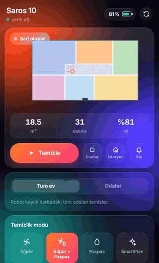
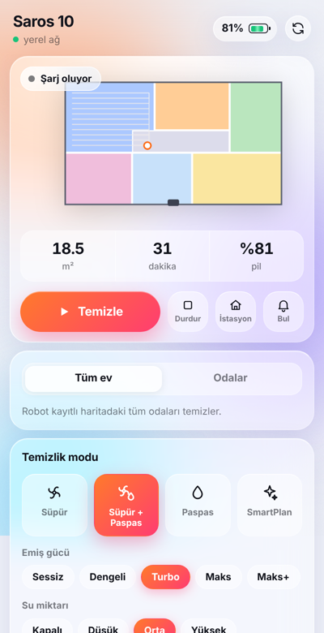
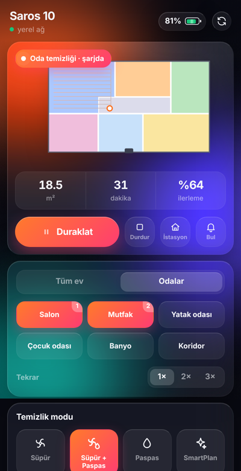

<p align="center">
  
</p>

<h1 align="center">OpenSpruce</h1>

<p align="center">
  A macOS menu bar controller for Roborock robot vacuums: a glassmorphism control panel, one click away.
</p>

<p align="center">
  
</p>

<p align="center">
  
  &nbsp;
  
</p>

<sub>Screenshots use sample data and a placeholder map.</sub>

## Features

- **Live status:** state, battery, connection (local network or cloud), area, time and progress
- **Live map** of your home, refreshed while the robot cleans
- **Controls:** start, pause, stop, return to dock, locate
- **Room cleaning:** pick rooms, set the repeat count, start
- **Cleaning modes:** vacuum, vacuum + mop, mop only, SmartPlan, plus suction power, water level and mop route
- **Dock actions:** empty dustbin, wash mop, dry mop, auto-dry toggle
- **Maintenance:** brush, filter and sensor life with reset
- **Settings:** do not disturb, child lock, volume
- **Routines** from the Roborock app
- **Notifications** when cleaning finishes or an error occurs
- **Look and feel:** follows macOS light/dark mode and respects "Reduce motion"

Developed and tested with a **Roborock Saros 10** (`roborock.vacuum.a147`). Other Roborock vacuums that use the V1 protocol should work, though features depend on the model and dock.

> **Note:** The interface is currently in Turkish. Translations are welcome (see [Contributing](#contributing)).

## Requirements

- macOS 13 or newer (Apple silicon or Intel)
- Python 3.11+ (the installer uses Homebrew to install it if missing)
- A Roborock account (the same one you use in the Roborock app)

## Install

```bash
git clone https://github.com/kenangunen/openspruce.git
cd openspruce
bash install.sh
```

The installer will:

1. create a virtual environment and install the dependencies
2. ask for your Roborock e-mail and the 6-digit code Roborock sends you
3. register a login item so OpenSpruce starts with your Mac, then launch it

Click the icon in the menu bar to open the panel.

> On MacBooks with a notch, a crowded menu bar can hide new icons behind the notch. Hold <kbd>⌘</kbd> and drag some icons out to make room.

### Update

```bash
git pull && bash install.sh
```

### Uninstall

```bash
bash uninstall.sh
```

Credentials and settings live in `~/Library/Application Support/OpenSpruce/`. Delete that folder to remove them.

## Troubleshooting

| Problem | Fix |
| --- | --- |
| Icon doesn't appear | `tail -40 ~/Library/Application\ Support/OpenSpruce/stderr.log` |
| Login code rejected | `bash install.sh --relogin` (enter the code, not your e-mail) |
| "Too many codes requested" | Wait 30–60 minutes, then retry |
| Run in the foreground for debugging | `.venv/bin/python -m openspruce.app` |

## How it works

```
menu bar icon ──► NSPopover ──► WKWebView (openspruce/ui/index.html)
                                   │  ▲
                     postMessage   │  │  window.render(state)
                                   ▼  │
                               app.py (PyObjC)
                                   │
                               backend.py ── asyncio thread
                                   │
                            python-roborock ──► robot (local TCP / Roborock cloud MQTT)
```

- **`openspruce/backend.py`** talks to the robot through [python-roborock](https://github.com/python-roborock/python-roborock), the library behind Home Assistant's Roborock integration. It polls status (every 8 s while cleaning, every 30 s when idle), listens for pushed updates, and exposes plain-dict snapshots plus a small set of actions.
- **`openspruce/app.py`** is the native shell: status item, popover, web view and a JavaScript bridge.
- **`openspruce/ui/index.html`** is the whole interface in a single file (HTML, CSS and JS, no build step). Open it in a browser to preview it with sample data.

Your Roborock token is stored locally (`user.json`, readable only by you) and is only sent to Roborock's own servers.

## Contributing

Issues and pull requests are welcome, especially:

- translations (strings live in `openspruce/ui/index.html` and `openspruce/labels.py`)
- reports from owners of other Roborock models

## Disclaimer

OpenSpruce is an independent project. It is not affiliated with, endorsed by, or sponsored by Roborock. "Roborock" and "Saros" are trademarks of their respective owners. Use at your own risk.

## License

[MIT](LICENSE). Built on [python-roborock](https://github.com/python-roborock/python-roborock) (Apache-2.0).
